<!-- Draft README for the public release. Images are generated: node docs/readme/gen.js -->
<!-- TODO: the images under docs/readme/ predate the cockpit and Critters redesign; regenerate them before release. The text below describes the mod as built. -->

<h1 align="center">Mission Control</h1>

<p align="center">
  <b>A command center for Claude Code:</b> tasks, agents, every step and what the session produced, beside the chat.
</p>

<p align="center">
  <!-- TODO: build badge: replace OWNER/REPO once the public repository exists -->
  <a href="https://github.com/OWNER/REPO/actions/workflows/ci.yml"></a>
  
  <!-- TODO: licence -->
  
</p>

<p align="center">
  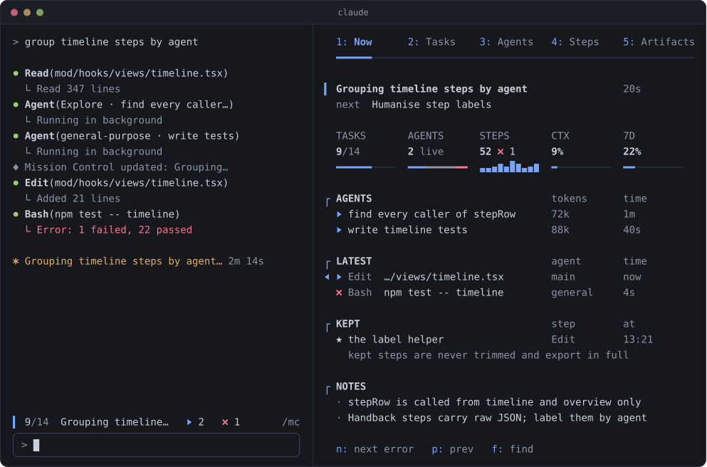
</p>

Mission Control is a mod for [Claude Code](https://claude.com/claude-code). It adds a pane beside the transcript and a one-line band above the prompt. The transcript itself stays as it is.

## Why

- **Long output buries the steps that matter.** A file dump or a test log pushes the one edit you wanted to check off screen, and scrolling back for it is slow.
- **Subagents and workflows are hard to follow.** Several agents run at once, and the chat shows one line for each.
- **Sessions end without a record.** What was decided, what failed and what was produced are spread over hundreds of rows.

Mission Control keeps all of it one keypress away: what Claude is doing now, what waits on you, every step with its input and result, and the things worth keeping.

## Features

| | |
|---|---|
| 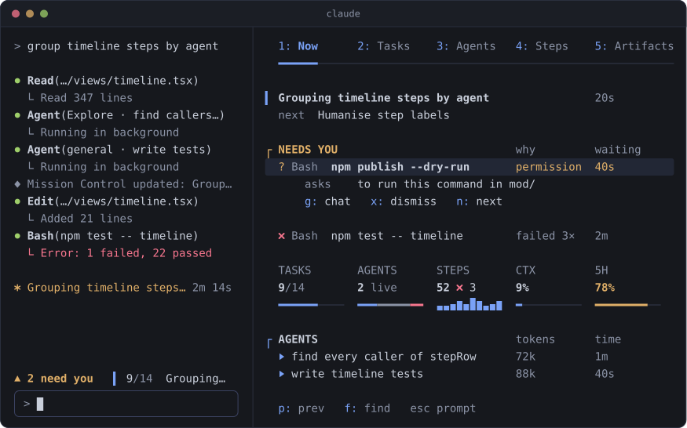 | **Now**<br>A header with a pill (WORKING, WAITING FOR YOU, STOPPED, ALL DONE or IDLE), the time this turn, the request's goal and two gauges. Under it **Needs you** (only what blocks the session on a dialog: a permission, a question, a plan or an input request) and **Watch** (a stalled step, a quiet agent, a long run, a repeat; it asks nothing of you), then To do, Agents, and Notes and decisions. |
| 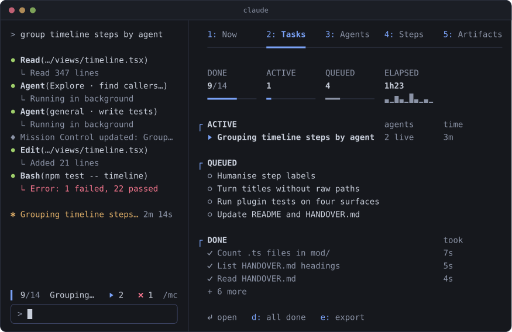 | **Tasks, with their sub-agents**<br>How far along the request is, with Effort so far, Doing now (and its agents), Up next and Done. `d` unfolds the done tasks. |
| 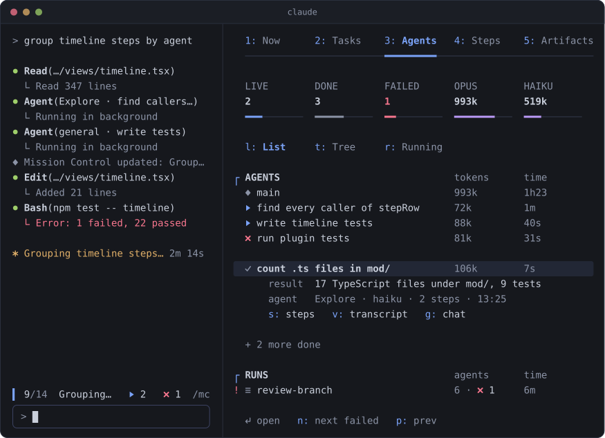 | **Agents**<br>Main and every subagent as a card or a map node, with tokens and time: live first, then failed, then done. Open a row for its result, type and model, then go to its steps or its transcript. Workflow runs get a row under **RUNS** that opens the run board. |
| 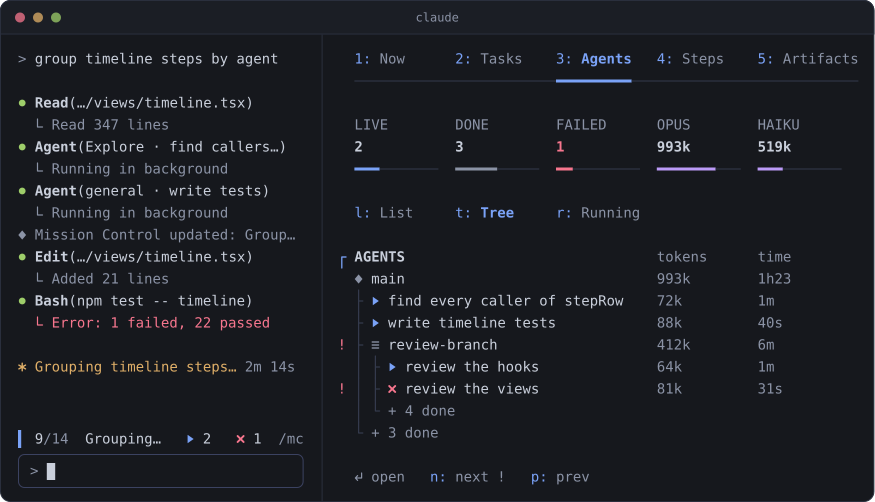 | **Agent map**<br>`t` draws the same agents as a map, with a workflow run as a branch. A `!` marks a failed agent and every folded branch above it. `r` hides everything that is not running. |
|  | **Steps**<br>Every tool call of the session, grouped by turn. `f` finds across all of them and underlines the hits. Chips filter to kept steps, errors and **In view**. A `◂` marks the rows that are on screen in the chat right now. |
| 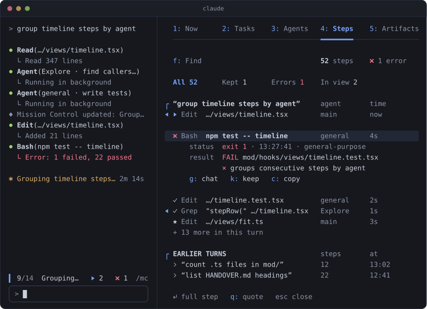 | **Open a step, keep a step**<br>Enter opens a step in place: status, the result and `g: chat  k: keep  c: copy`. Enter again shows the full step with its input, result and the diff of any change. **Keep** (`k`) stars a step: kept steps are never trimmed and export in full. |
| 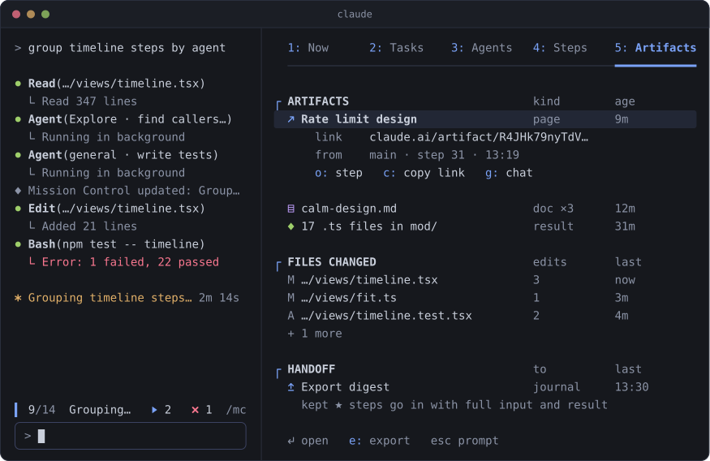 | **Artifacts and handoff**<br>The pages Claude published, the documents it wrote, the results it reported and the files it changed, newest first. `e` exports a digest of the session to the journal and the clipboard, ready for the next session or a teammate. |
| 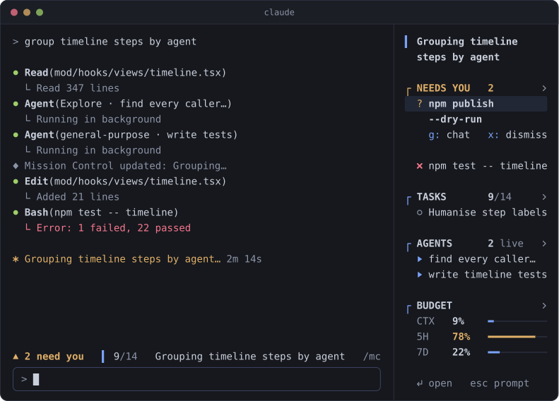 | **Budget**<br>Context use and the rate-limit windows as bars, bold from 70 % and red from 90 %. Enter on the readouts opens every window with its reset time and the tokens per model. Dollar cost is opt-in. |
| 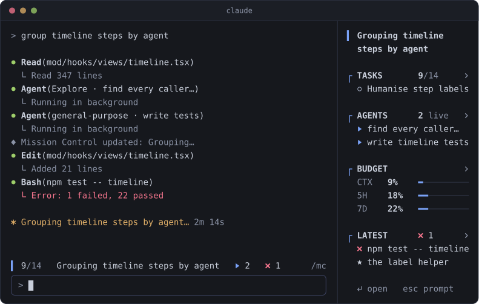 | **Slim sidebar**<br>`/mc slim` shrinks the pane to 28 columns: one stacked summary of focus, needs-you, tasks, agents, budget and latest. Enter on a section opens it. `/mc slim` again restores the full width. |

### The band

<p align="center">
  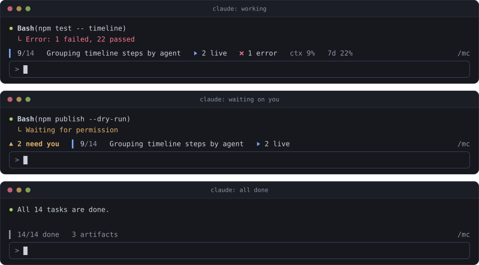
</p>

One row above the prompt, shown even when the pane is closed: a small picture of the lead, the request's goal and the context and week figures. When a dialog waits on you, "Needs you" and the ask lead in amber; after a failed turn it leads with "Stopped". A second row holds the to-do bar when there is room. As the terminal narrows it drops the gauges first, then cuts the goal at a word boundary.

### Narrow terminals

<p align="center">
  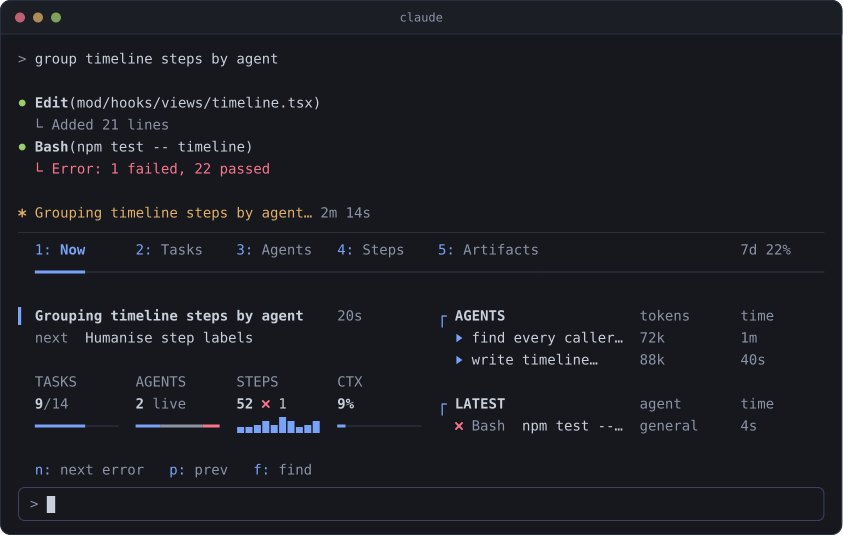
</p>

`/mc strip` puts Mission Control above the prompt as a strip, on the same grid: Now's header on the left, To do and Agents on the right. The pane itself draws the strip from 96 columns.

## Install

Requires **Claude Code 2.1.325 or newer**.

**Try it for one session.** Clone the repository and start Claude Code with the mod folder:

```sh
claude --plugin-dir ./mod
```

The folder is watched, so saving a file reloads the mod and keeps its state.

**Always on.** Put the absolute path of `mod/` in `CLAUDE_CODE_PLUGIN_DIRS` under `env` in `~/.claude/settings.json`:

```json
{ "env": { "CLAUDE_CODE_PLUGIN_DIRS": "/absolute/path/to/mission-control/mod" } }
```

**From a marketplace.** <!-- TODO: marketplace install (needs .claude-plugin/marketplace.json and a published location) --> Not available yet.

## Usage

Type `/mc`. The band is always there; the pane opens when you ask for it.

| Command | Does |
|---|---|
| `/mc` | Opens the pane. |
| `/mc 1` to `/mc 5` | Opens the pane on that tab: Now, Tasks, Agents, Steps, Artifacts. |
| `/mc keep <note>` | Keeps the newest step of the main conversation, with a note. |
| `/mc export` | Writes the session digest to the journal and copies it. |
| `/mc close` | Closes the pane. |
| `/mc slim` | Switches between the slim sidebar and the full width. |
| `/mc strip` | Draws the strip above the prompt instead of the pane. |
| `/mc options` | Opens the Options page. |

All of them work in the middle of a turn.

<details>
<summary><b>Keys</b></summary>

<br>

| Key | Does |
|---|---|
| <kbd>Ctrl</kbd>+<kbd>X</kbd> <kbd>Tab</kbd> | Focus the pane. Remap it with the `abovePrompt:focus` action in `~/.claude/keybindings.json`. |
| <kbd>Esc</kbd> | Back to the prompt. |
| <kbd>Ctrl</kbd>+<kbd>X</kbd> <kbd>X</kbd> | Close the pane. |
| <kbd>1</kbd> to <kbd>5</kbd> | Switch tab. |
| <kbd>Tab</kbd>, <kbd>Enter</kbd> | Move between rows; open a row. |
| <kbd>0</kbd> | Open the Options page. |
| <kbd>n</kbd> / <kbd>p</kbd> | Next or previous ask, flagged agent, error or find hit. |
| <kbd>f</kbd> | Find in steps. |
| <kbd>g</kbd> | Show the row in the chat. |
| <kbd>k</kbd> | Keep or unkeep a step. |
| <kbd>c</kbd> | Copy as Markdown. |
| <kbd>q</kbd> | Quote into the prompt (full step). |
| <kbd>l</kbd> / <kbd>t</kbd> / <kbd>r</kbd> | Agents: list, map, working only. |
| <kbd>s</kbd> / <kbd>v</kbd> | Agent: its steps, its transcript. |
| <kbd>d</kbd> | Tasks: show all done tasks. |
| <kbd>e</kbd> | Export the digest. |
| <kbd>x</kbd> | Dismiss a Watch row. A need cannot be dismissed. |

Keys reach the pane only while it has focus. Every action is also a button with a label, so nothing depends on a hotkey.

</details>

<details>
<summary><b>Options</b></summary>

<br>

Set them from the plugin's config menu, or under `pluginConfigs["mission-control"].options` in a settings file.

| Option | Default | What it does |
|---|---|---|
| `autoOpen` | `false` | Open the pane when a session starts. |
| `guide` | `true` | Add the update tool and one system-prompt section so Claude keeps the panel current. |
| `look` | `"auto"` | `auto`, `rich` or `text`: how the pane and band are drawn. |
| `ground` | `"auto"` | `auto`, `night` or `day`: the background the crew pictures and the desktop Svg are drawn for. |
| `motion` | `"on"` | `on` or `off`: whether the crew blinks and the finish sweep plays. |
| `accent` | `"iris"` | `iris`, `sky` or `slate`: the colour of headings and the marker. |
| `notify` | `"waits"` | Native notifications: `waits`, `done`, `all` or `off`. Claude Code itself notifies for permission dialogs; this option covers the rest. <!-- TODO: notify wording, to match the alert model once it is settled --> |
| `watchNotify` | `false` | Also notify, once, when something has stood under Watch for 10 minutes. |
| `agentLimitMin` | `60` | Show a subagent still working after this many minutes as a long run under Watch (`0` is off). |
| `turnLimitMin` | `120` | The same for a main turn. |
| `showCost` | `false` | Show the session's dollar cost in the budget view. |

For a one-off headless run, pass them with `--settings`:

```sh
claude -p "..." --plugin-dir ./mod --settings '{"pluginConfigs":{"mission-control":{"options":{"guide":false}}}}'
```

</details>

## Privacy, and what it adds to Claude

- **Hooks only observe.** Every capture hook returns exactly what Claude Code produced. The mod does not change tool input, tool output or your prompts.
- **No model calls.** The mod never calls a model and makes no network requests. Labels, summaries and the digest are computed from what the session already did.
- **One tool and one system-prompt section.** That is all the mod adds to a conversation, and `guide: false` removes both.

<details>
<summary><b>The exact text added to the system prompt</b></summary>

<br>

With `guide` on, the mod registers one tool, `mcp__mission-control__update` (fields `focus`, `next`, `note`, `artifact`), and adds this section to the main conversation's system prompt. The text is the same on every request, so the prompt cache holds.

```text
# Mission Control
The person follows this session in a side panel called Mission Control. Keep it current:
- Keep the task list up to date with the task tools as work starts and finishes.
- When a request needs tools, include a mcp__mission-control__update call with `focus` (and `next` when you know it) alongside your first tool call(s), and again whenever what you are working on changes; skip it for replies that need no tools. One short line each.
- Add `note` when you learn something the person would want to find again later: a decision, a root cause, a surprising fact. One line.
- Add `artifact` when you produce a result or a link worth keeping (review findings, a report, a pull request).
Batch these into one call, at most once per step, and never call it only to say nothing changed. Do not mention the panel or these updates in your replies.
```

</details>

**The journal.** Step bodies and a copy of the timeline are written to `~/.claude/mission-control/<session-id>/` on your machine: `timeline.json`, a `steps/` folder, any `export-<stamp>.md` digests you exported and, for a resumed session, a `journal.json` link to the folder it continues. The newest 20 sessions are kept and older ones are pruned at session start; a folder less than 24 hours old is never pruned. To delete the journal, remove `~/.claude/mission-control/`.

## Development

```sh
npm install
claude --plugin-dir ./mod      # run with the mod; reloads on save
claude plugin validate ./mod   # static check
claude plugin test ./mod       # hook and drawing tests, no session or network
npx tsc -p mod                 # type check
npm test                       # model tests (vitest); CI runs these
node docs/readme/gen.js        # regenerate the README images
```

<details>
<summary><b>Layout of the repository</b></summary>

<br>

| Path | Holds |
|---|---|
| `mod/.claude-plugin/plugin.json` | The manifest and the options. |
| `mod/hooks/` | The hooks module: capture, journal, guide. |
| `mod/hooks/model/` | The pure session model, tested with vitest from `test/`. |
| `mod/hooks/views/` | The pane, the band and their drawing tests. |
| `docs/superpowers/specs/` | Design notes. The current one is the [cockpit design](docs/superpowers/specs/2026-11-15-mission-control-cockpit-design.md). |
| `docs/readme/` | These images and `gen.js`, which draws them on the design's character grid. |

`claude --debug-file mod-debug.log --plugin-dir ./mod` logs why a hook was skipped. The engine lays its type file in `mod/.claude-plugin/types/` on first load; that file is the API authority.

</details>

## FAQ and limits

**Do subagents keep the panel current too?** They are tracked: their steps, tokens and results all show. They do not see the guide, though. Claude Code does not raise the system-prompt event for subagent or workflow-agent prompts, so an agent's "doing now" line comes from its steps, not from notes it writes.

**Do the hotkeys work in VS Code?** No. Hotkeys work in the terminal and the desktop app. In VS Code every action is still reachable as a labelled button.

**Does it use tokens?** The pane itself uses none. With `guide` on, the system-prompt section and Claude's short `update` calls use a few; `guide: false` turns both off, and the pane then shows only what it can observe.

**Why did the pane not open by itself?** `autoOpen` is off by default, and a pane that opens unasked waits for a wide enough terminal. `/mc` opens it at any width.

## Contributing

<!-- TODO: contributing guide -->
Issues and pull requests are welcome once the repository is public. Run the five checks under [Development](#development) before you open one.

## Licence

<!-- TODO: licence -->
To be decided.
