<h1 align="center">Binnacle</h1>

<p align="center">
  <b>A calm cockpit for Claude Code.</b><br>
  What Claude is doing, whether it needs you, how far along it is, and what the session produced, beside the chat.
</p>

<p align="center">
  
  
  
</p>

<p align="center">
  <picture>
    <source media="(prefers-color-scheme: light)" srcset="docs/readme/hero-day.png">
    
  </picture>
</p>

Binnacle is a mod for [Claude Code](https://claude.com/claude-code). A long session buries the steps that matter under file dumps and test logs, shows one line for each of several agents, and ends with nothing to hand on. Binnacle keeps a pane beside the transcript and a band above the prompt that answer three questions at a glance: what is happening, does anything need me, and how far along is it. It records every step so you can reopen one after it has scrolled away, and it writes a digest when you are done. The transcript itself stays as it is.

> [!NOTE]
> Every picture on this page is drawn from the mod's own views with test data (`node docs/readme/tools/make.mjs`). The chat on the left of the first picture is an illustration. Text colours in a real terminal come from your Claude Code theme; here they use the cockpit's own palette.

## Contents

- [What you see](#what-you-see)
- [Features](#features): [Now](#now-three-questions-always-in-the-same-place) · [Pull request and stack](#pull-request-and-github-stack) · [Needs you and Watch](#needs-you-and-watch) · [To do](#the-to-do-list) · [Agents and Critters](#agents-the-crew-map-and-the-critters) · [Steps](#steps-and-keep) · [Artifacts and handoff](#artifacts-and-the-handoff-digest) · [Budget](#gauges-and-budget) · [Band](#the-band) · [Slim, strip, desktop](#slim-strip-and-the-desktop-app) · [Looks](#looks-and-small-delights)
- [Install](#install) · [Commands](#commands) · [Keys](#keys) · [Options](#options)
- [Privacy, and what it adds to Claude](#privacy-and-what-it-adds-to-claude)
- [Development](#development) · [Known limits](#known-limits) · [Contributing](#contributing) · [Security](#security) · [Licence](#licence)

## What you see

### Three ways to show it

Pick one with the **Show as** option (the Options tab, `0`, or `/config`); it holds in every session. On the Options tab, Enter on Show as switches at once. Under `band` or `strip` the pane closes and a row stays on top, `Show as  1: pane  2: band  3: strip  0: keep`: type the digit into the empty prompt to try the next style, `1` to go back to the pane (on Options), or `0` to keep the style and drop the row. `/binnacle options` also brings the pane back. The commands switch for the moment.

| Show as | What you get | For the moment |
|---|---|---|
| `pane` (default) | The pane beside the chat with every tab, and a one-row band above the prompt. | `/binnacle` |
| `band` | No pane. Two minimal rows above the prompt: the lead's Critter, the goal, the to-do bar, context and week, and the PR chip. Needs a terminal at least 80 columns wide (one row below that). | `/binnacle close` (or <kbd>Ctrl</kbd>+<kbd>X</kbd> <kbd>X</kbd>) |
| `strip` | No pane. All of Now laid on its side above the prompt: the header, Needs you (or "Nothing needs you"), Watch, the PR, To do and Agents. | `/binnacle strip` |

<p align="center">
  
</p>

### Every part

| Where | What it is |
|---|---|
| **Pane** | Docks beside the transcript. Five tabs, keys `1` to `5`, and an Options tab, `0`, at the right end of the tab bar. |
| **1 Now** | The header (state, time this turn, the goal, context and week as rings; `header: slim` for a 4-row one), Needs you only when something does, the pull request and its GitHub stack, then To do, Notes and decisions, the newest Artifacts, and Agents. |
| **2 Tasks** | How many tasks are done, the pace, effort per task, then Doing now with its agents, Up next and Done. |
| **3 Agents** | Main and every subagent or workflow agent, as a list of cards or as the Crew map. |
| **4 Artifacts** | What the session produced: published pages, documents, results, links, changed files, kept steps, and the handoff export. |
| **5 Steps** | Every tool call of the session, grouped by turn, filterable and searchable. A step opens in place. |
| **Band** | Above the prompt, always: two rows with the pane closed (from 80 columns), one row while the pane is open, one dim row when all is done. Before anything happens the lead's Critter peeks up from below beside "Ready when you are", a small companion that never leaves. |
| **Slim** | Under 32 columns the pane is one stacked summary with no tab bar; it keeps the "Nothing needs you" line, a one-line Watch (or "quiet 30 min") and the PR as a chip. |
| **Strip** | Now on its side; `/binnacle strip` (or Show as `strip`) puts it above the prompt instead of the pane. A pane 96 columns or wider draws Now this way too. |
| **Desktop app** | The Now header and the band are drawn as pictures (Svg), ending at the header, in the same words and colours. |

Options sits at the right end of the tab bar. To make room for it the tabs close up: on the default 62-column pane they read `1:Now 2:Tasks …` and the last tab `0:Options`; a wider pane spaces them out as `1: Now` and `0: Options`. The tab bar shortens with the pane: full names from 54 columns, then the short words `Now Tasks Crew Files Steps` (and `Opts`) down to 38, and icons only under 38, where Options is not drawn but `0` still opens it.

## Features

### Now: three questions, always in the same place


**What is happening** is the header: a pill, the time this turn, the goal of the request beside the lead's Critter, and two ring gauges for context and this week. **Does anything need me** stays silent until something does: then the Needs you block appears right under the header. There is no "all clear" line; an empty slot means nothing waits. **What am I shipping** is the pull request and its stack. **How far along** is the to-do list, with the current task marked `now` and the one after it `next`, followed by Notes and decisions and the three newest artifacts (a press opens one). The lists you read get the room first: spare rows go to To do until every task shows, then the blocks spread apart, and Agents sits at the foot of the pane.

Want more room for the lists? `header: slim` draws the header in four rows, with context and week as figures ([see it](docs/readme/now-slim.png)).

Now holds no log and no Watch rows. There is no command line scrolling by, no step count and no error count: the things that change every second live on the Steps tab, so this page stays readable from across the room. An agent says what it is doing in words ("Searching src/server", "Editing test/rateLimit.test.ts"), not as a tool call.

The pill has five states, each in its own colour:

<br clear="right">

<p align="center">
  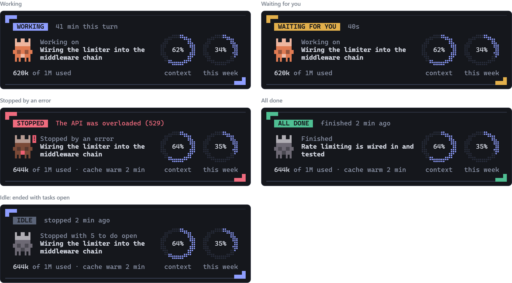
</p>

A turn that failed is STOPPED with its reason in red. A request that ends with tasks still open reads IDLE and says how many, never ALL DONE. After two quiet minutes the header adds "quiet 6 min" beside the turn time. The cache countdown ("cache warm 2 min") shows only at rest.

### Pull request and GitHub stack

<p align="center">
  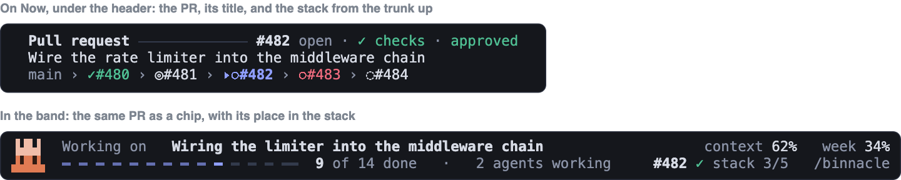
</p>

When the branch you are on has a pull request, Now shows it under the header (and under Needs you, when something waits): its number, state, checks and review, and its title. On a [GitHub stack](https://github.com/github/gh-stack) (`gh stack`) a third row lists every branch of the stack from the trunk up. Each carries a mark: `✓` merged, `◎` in the merge queue, `○` open, `◌` draft, `✕` closed; a PR whose checks fail is red, and `▸` is the cursor, on your branch to begin with. Press a PR, or `o`, to open it in the browser; `h` moves the cursor down the stack toward the trunk and `l` up it, and `o` then opens the one under the cursor. The band shows the same as a chip, `#482 ✓ stack 3/5`. The strip shows the whole block, and slim the chip.

The mod asks `gh` (and `gh stack` when it is installed) at session start, two seconds after a `git` or `gh` command that can move the branch or a PR, and every three minutes. Without `gh`, without a remote or offline, the block simply stays away.

### Needs you and Watch

<p align="center">
  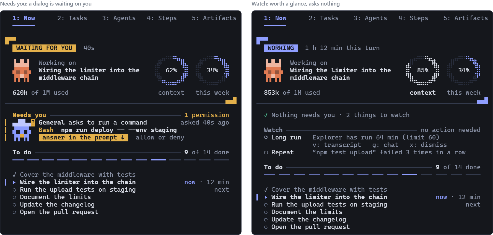
</p>

Most dashboards shout about everything. This one keeps two lists apart, so amber always means the same thing.

- **Needs you** holds only what blocks the session on a dialog: a permission, a question, a plan to approve, or an MCP server's input request. It says who asks and what for, and points you to the prompt. It has no dismiss key; it clears when the dialog is answered.
- **Watch** holds what is worth a glance and asks nothing. It stays off Now (the band's one-row form counts it, slim and the strip show it): a step that has run far longer than usual, an agent that has gone quiet for 10 minutes, a long run (60 minutes for an agent, 120 for a turn; both are options), the same command failing again, and a loop. Watch is never amber, never takes the keyboard, and `x` dismisses a row.

Amber is used for a dialog and nothing else. A gauge that fills up turns bold at 70 % and red at 90 %, not amber.

### The to-do list

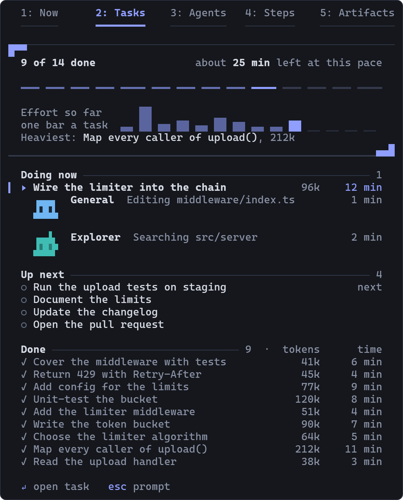

The list comes from Claude's own task tools. With the `guide` option on (the default), the mod adds one section to the system prompt that asks Claude to write a list for any request of three or more steps, as outcomes you would recognise, and to keep exactly one task in progress. When Claude has no task tool, it sends the list through the mod's one tool instead.

The Tasks tab adds what Now leaves out: a pace estimate, the effort each task cost, the agents working on the current task, and tokens and time for every finished one. The lists grow with the pane's height, and `d` shows every done task. A list belongs to one request: when a new prompt starts and every task is complete, the old list folds away under Earlier.

A subagent's own list stays on its card ("3 of 5"); the header's count is the lead's list only.

<br clear="right">

### Agents, the Crew map and the Critters

<table>
<tr>
<td width="50%" valign="top">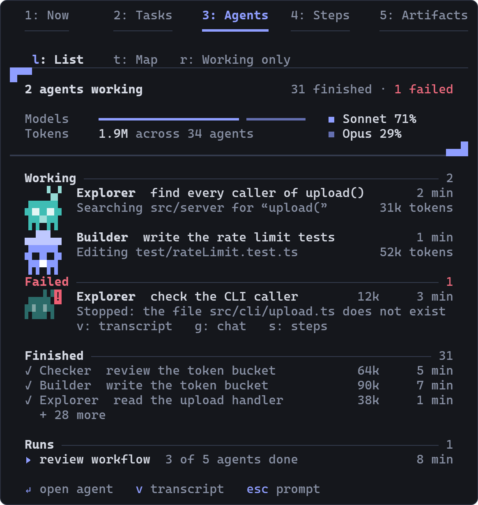</td>
<td width="50%" valign="top"></td>
</tr>
<tr>
<td valign="top"><b>List</b> (<code>l</code>). Working agents get a card: who, the job, what it is doing right now, time and tokens. A failed agent shows its reason and one-key jumps to its transcript, its place in the chat and its steps. Finished agents fold to dim rows. Workflow runs get a row that opens the run board.</td>
<td valign="top"><b>Crew map</b> (<code>t</code>). The same agents hung on the tasks they belong to. Only living agents are drawn; finished ones become pips, so 35 agents cost about the rows of two. A waiting or failed agent is never folded away, and its <code>?</code> or <code>!</code> climbs into the gutter. <code>r</code> hides everything that is not working.</td>
</tr>
</table>

The name beside a Critter is the agent's real type in friendly case ("General", "Explorer", "Code reviewer"). The accessory and the colour are only a hint.

<p align="center">
  
</p>

**Critters** are the agents: small pixel characters drawn from the terminal's own block characters, three rows tall, or two in the band and the slim pane. The colour and the accessory are the role (a crown, a hard hat, an antenna, glasses, or nothing for a general agent), and the face and the badge are the state, so a glance tells you who is waiting on you and who has failed without reading a word. Only the lead wears the crown. A working Critter blinks about every four seconds. A change of state plays one short move, once: a new agent squashes and hops, a finished one nods and greys before its card folds, an agent that asks glances at its badge and hops, a stalled one droops, a failed one flinches. `motion: off` keeps everyone still.

### Steps and Keep


This is the log that Now leaves out: every tool call, grouped by the prompt that caused it, with the agent and the time. `f` finds across all of them, including inside stored results. Chips filter to kept steps, errors, and the rows that are on screen in the chat right now (marked `◂`).

Enter opens a step in place with its result. Enter again opens its page with the input, the full result and the diff of any change. From there `g` shows it in the chat, `c` copies it as Markdown, `q` quotes it into the prompt and `o` opens the file in your editor.

**Keep** (`k`, or `/binnacle keep <note>`) marks a step you do not want to lose. A kept step shows a `★`, appears in Notes and decisions on Now and in Kept on Artifacts, is never trimmed from the timeline, and goes into the export in full.

<br clear="right">

### Artifacts and the handoff digest


A session ends with something to show for it: pages Claude published, documents it wrote, results it reported, links, and the files it changed with an edit count each. The newest artifact is open; `o` jumps to the step that made it and `c` copies its link.

**Handoff** is the top of the tab. `e` (or `/binnacle export`) writes a Markdown digest and copies it to the clipboard, ready to paste into the next session or send to a teammate. The digest holds the request, the task list with its marks, the notes, every kept step with its stored input and result, the artifacts, the changed files and anything still open. The bar shows what it will contain before you press.

<br clear="right">

### Gauges and budget

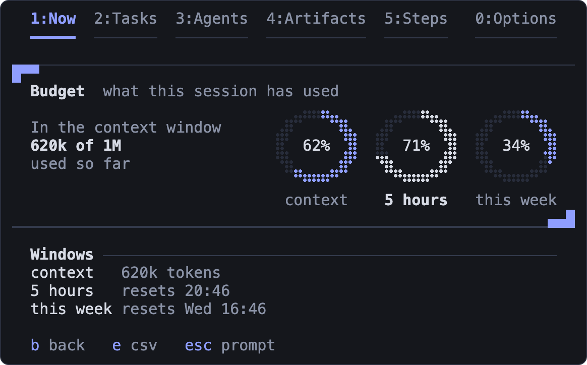

The header carries two gauges: the context window, and the hotter of your rate-limit windows. The slim header (`header: slim`) shows them as figures instead (`context 62%   this week 34%`). Under 70 % they sit quietly in the accent; from 70 % the figure and its label turn bold, and from 90 % red.

`b` on Now opens the budget view: all three windows with their reset times, then tokens by model and by agent. `e` there writes a ledger of your sessions as CSV. No dollar figure is drawn anywhere unless you turn `showCost` on.

A toast tells you once when the context reaches 80 %.

<br clear="right">

### The band

<p align="center">
  
</p>

The band sits above the prompt and is there even when the pane is closed, so the three answers never leave the screen. It shows one Critter (the lead, or whoever is asking), the goal, the to-do bar and the gauges as words. A dialog turns it amber and names the ask. Watch never colours it. When everything is done it shrinks to one dim row with the lead peeking up beside it, and while the pane is open it is one compact row. It never disappears: before anything happens the lead's Critter peeks up from below beside "Ready when you are", so a new session already shows where Binnacle lives. It also carries the PR chip (`#482 ✓ stack 2/3`). The one-row form (pane open, or under 80 columns) counts what is under Watch ("2 to watch"); the two-row form does not. A narrow band drops the gauges first, and cuts the goal only at a word.

### Slim, strip and the desktop app

<p align="center">
  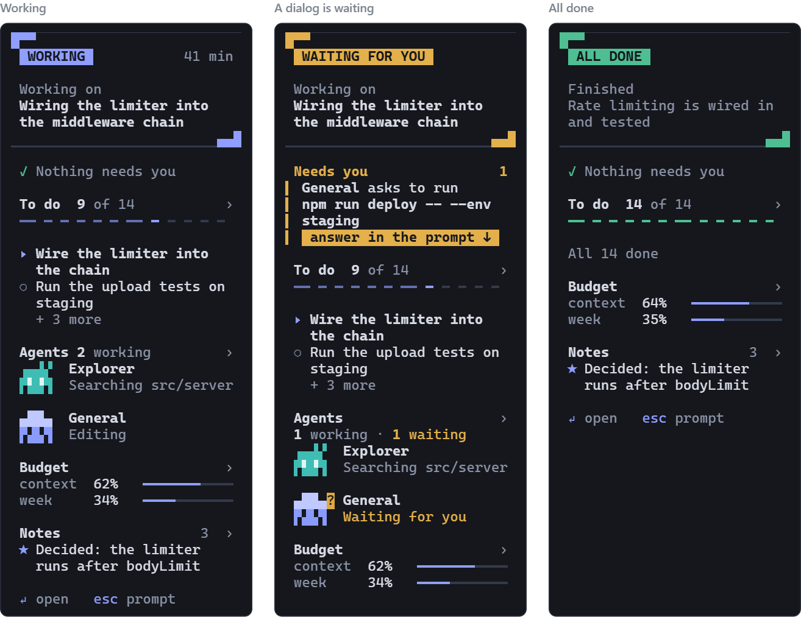
</p>

**Slim.** `/binnacle slim` asks for a 28-column pane; any pane under 32 columns draws this way. There is no tab bar: each title opens its tab. A line under Needs you shows how many things to watch and the top one, or "quiet 30 min" when nothing else is up. When rows run short, whole blocks go from the bottom, and Needs you is kept longest.

<p align="center">
  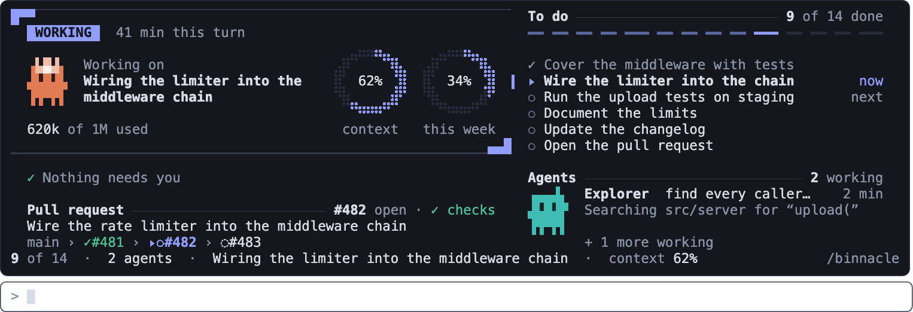
</p>

**Strip.** `/binnacle strip` closes the pane and draws Now on its side above the prompt, for when you want the full width for the chat. From 96 columns it has two columns; narrower, the same blocks stack in one, the Pull request included. The pane itself uses the two-column layout from 96 columns. When a dialog waits, the strip puts the ask first, ahead of the header. The strip never takes more than half the terminal's height. A click on a row opens the pane there.

<p align="center">
  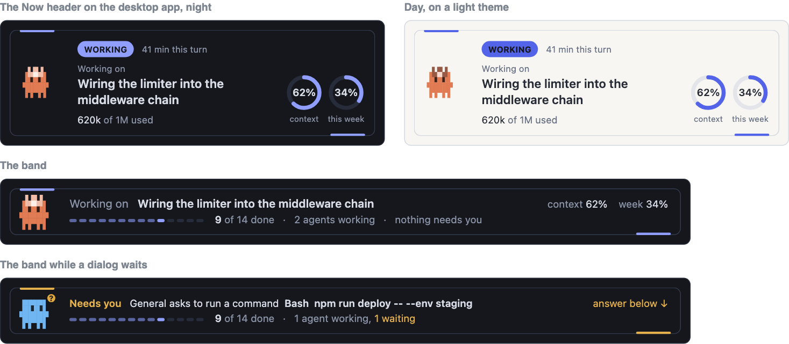
</p>

**Desktop app.** The Now header and the band are drawn as Svg from the same model as the terminal's, in the same words, on the night or day ground to match your theme. Each picture's alt text says what the picture says. VS Code and mobile take the text form.

### Looks and small delights

<p align="center">
  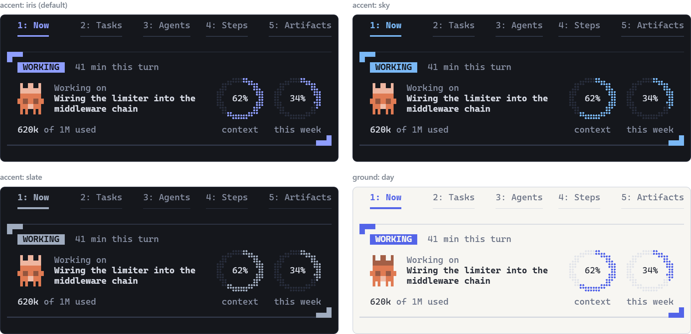
</p>

- **Accent**: `iris`, `sky` or `slate`. None of them is a state colour, so the accent never reads as a warning.
- **Ground**: the pictures are mixed for a dark (`night`) or light (`day`) background. `auto` follows your theme.
- **Look**: `rich` draws Critters, rings and charts where the terminal can. `text` draws letters and lines only, for a terminal whose glyphs render badly, or a screen reader. `auto` picks text on an ANSI or daltonized theme.
- **A clean finish** gets one short sweep of the accent along the header, under a second, once, and the lead hops and greys with it. Never in the band, never while something needs you, and off with `motion: off`.
- **Small moves, once each**: a finished task flashes its bar segment and lights the next (the band shows the new count in the accent for a second), a new step marks its row for a beat and grows its column on the step map, the gauges fill when the pane opens on Now or when one jumps, and Needs you comes in at half strength for a frame before full amber. Nothing repeats or loops but the blink, and nothing moves at rest. `motion: off` shows only where each one ends.
- **Toasts** only when the number means something: "All 14 done", "Context at 80%", and "5 agents finished" as one toast, not five. A finished agent's toast waits about a second and a half, so agents that finish together share one.

<details>
<summary><b>The text look and the Options page</b></summary>

<br>

<table>
<tr>
<td width="50%" valign="top">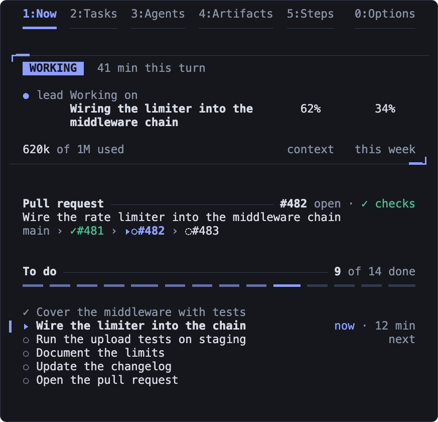</td>
<td width="50%" valign="top"></td>
</tr>
<tr>
<td valign="top">The text look carries every word of the rich one.</td>
<td valign="top"><code>0</code> or <code>/binnacle options</code>. Enter changes the row you are on, in place; the right column says what it will set next. Look options apply at once. The Never section lists what the mod will not do.</td>
</tr>
</table>

</details>

## Install

Requires **Claude Code 2.1.325 or newer**. The mods API is early access.

**Try it for one session.** Clone the repository and start Claude Code with the mod folder:

```sh
claude --plugin-dir ./mod
```

Then type `/binnacle`. The band is there from the start; the pane opens when you ask for it.

**Always on.** Put the absolute path of `mod/` in `CLAUDE_CODE_PLUGIN_DIRS` under `env` in `~/.claude/settings.json`:

```json
{ "env": { "CLAUDE_CODE_PLUGIN_DIRS": "/absolute/path/to/binnacle-claude-mod/mod" } }
```

**From a marketplace.** Not available yet.

## Commands

All of these work in the middle of a turn. They are the only commands.

| Command | Does |
|---|---|
| `/binnacle` | Opens the pane. |
| `/binnacle 1` to `/binnacle 5` | Opens the pane on that tab: Now, Tasks, Agents, Artifacts, Steps. |
| `/binnacle keep <note>` | Keeps the newest step of the main conversation, with the note. |
| `/binnacle export` | Writes the digest to the journal and copies it. |
| `/binnacle close` | Closes the pane. |
| `/binnacle slim` | Switches between the slim pane (28 columns) and the full one (62). |
| `/binnacle strip` | Closes the pane and draws the strip above the prompt; run again, it restores the band and reopens the pane. |
| `/binnacle options` | Opens the Options page. |

`/binnacle`, `/binnacle 1` to `/binnacle 5`, `/binnacle slim` and `/binnacle options` open the pane and so turn the strip off. `/binnacle close` leaves the strip as it is, and a `/clear` turns it off and folds the cleared conversation away: its tasks, agents and steps leave the pane.

## Keys

<kbd>Ctrl</kbd>+<kbd>X</kbd> <kbd>Tab</kbd> focuses the pane (remap it with the `abovePrompt:focus` action in `~/.claude/keybindings.json`). <kbd>↑</kbd> <kbd>↓</kbd> and <kbd>Tab</kbd> always move between rows and never just scroll, also right after a page opens or closes; <kbd>Page Up</kbd> <kbd>Page Down</kbd>, <kbd>Home</kbd> <kbd>End</kbd> and the wheel scroll a pane taller than the window, <kbd>Enter</kbd> opens one, <kbd>Esc</kbd> returns to the prompt, and <kbd>Ctrl</kbd>+<kbd>X</kbd> <kbd>X</kbd> closes the pane. The footer shows the hints that apply to the screen you are on.

<details>
<summary><b>Every hotkey</b></summary>

<br>

Hotkeys reach the pane only while it has focus. A key acts on the thing in view: the opened step, agent or artifact, or the row a footer hint names.

| Key | Does |
|---|---|
| <kbd>0</kbd> | Open or close Options (also the `0: Options` tab at the right of the tab bar). |
| <kbd>1</kbd> to <kbd>5</kbd> | Switch tabs. |
| <kbd>Enter</kbd> | Open the row; again for the full page. |
| <kbd>b</kbd> | Back from a page or from the budget view; on Now, open the budget view. |
| <kbd>n</kbd> / <kbd>p</kbd> | Next or previous ask, flagged agent, error or search hit. |
| <kbd>f</kbd> | Find in the steps. |
| <kbd>g</kbd> | Show the opened step, agent or artifact in the chat. |
| <kbd>k</kbd> | Keep the opened step, or unkeep it. |
| <kbd>c</kbd> | Copy the opened step as Markdown, an artifact's link, or a file's path. |
| <kbd>q</kbd> | Quote the full step into the prompt. |
| <kbd>l</kbd> / <kbd>t</kbd> | Agents: list, map. |
| <kbd>r</kbd> | Agents: working only. |
| <kbd>d</kbd> | Tasks: all done tasks. Agents: unfold or fold the finished ones. |
| <kbd>v</kbd> | An agent's transcript, from a Watch row or a failed agent. |
| <kbd>s</kbd> | A failed agent's steps. |
| <kbd>o</kbd> | An opened artifact: the step that wrote it. An opened file or step: open it in the editor. |
| <kbd>e</kbd> | Export the digest (Artifacts, and Now at rest). In the budget view: export the ledger as CSV. |
| <kbd>x</kbd> | Dismiss the first Watch row. A need cannot be dismissed. |
| <kbd>o</kbd> on Now | Open the pull request in the browser (on a stack, the one under the cursor). |
| <kbd>h</kbd> / <kbd>l</kbd> | Now: move the cursor down or up the GitHub stack. |

- On Artifacts the keys `o`, `c` and `g` belong to the one opened artifact or, once a file is selected, to that file; never to both.
- Hotkeys work in the terminal and the desktop app, not in VS Code. Every action is also a button with a label, so nothing depends on a key.
- The strip has no hotkeys, because a bare digit typed in an empty prompt could press a band button. The one exception is the Show as row (`1: pane  2: band  3: strip  0: keep`), drawn only while you try the styles, where that is the point.

</details>

## Options

Set them on the Options tab (`0`, at the right of the tab bar), from the plugin's config menu, or under `pluginConfigs["binnacle"].options` in a settings file. On the Options tab, <kbd>↑</kbd> <kbd>↓</kbd> move between options and <kbd>Enter</kbd> changes the one you are on: a switch flips, a choice steps to the next value, a time limit steps through 30, 45, 60, 90, 120, 180 and 240 minutes and off. The right column shows what Enter will set, or when the change applies (`next start`, `new thread`); the editor is set in `/config`. `0` or `b` leaves.

| Option | Default | What it does |
|---|---|---|
| `guide` | `true` | Give Claude the update tool and one system-prompt section so it keeps the panel current. |
| `autoOpen` | `false` | Open the pane when a session starts. In a narrow terminal the pane waits for more room. |
| `look` | `auto` | `auto`, `rich` or `text`: pictures where the terminal can draw them, or letters and box lines only. |
| `ground` | `auto` | `auto`, `night` or `day`: the background the pictures are drawn for. `auto` gives day on a light theme. |
| `showAs` | `pane` | `pane`, `band` or `strip`: the pane beside the chat, or no pane and only the minimal band, or Now on its side above the prompt. See [Three ways to show it](#three-ways-to-show-it). |
| `header` | `full` | `full` or `slim`: the 9-row Now header with the ring gauges, or a 4-row one (the goal beside the lead's Critter, context and week as figures) that leaves more room for the lists. |
| `accent` | `iris` | `iris`, `sky` or `slate`: the colour of headings, the marker and the filled button. |
| `motion` | `on` | `on` or `off`: whether the crew blinks and moves, and the finish sweep and the other one-shot moves play. |
| `notify` | `waits` | Native notifications: `off`, `waits`, `done` or `all`. See below. |
| `watchNotify` | `false` | Also notify, once, when something has stood under Watch for 10 minutes. |
| `agentLimitMin` | `60` | A subagent still working after this many minutes shows once as a long run under Watch. It only reports. `0` turns it off. |
| `turnLimitMin` | `120` | The same for a main turn. |
| `showCost` | `false` | Add the session's dollar cost to the budget view. |
| `editor` | `code` | The editor `o` opens a file in, run as `<editor> -r -g <path>:<line>`. When it cannot run, the path is copied. |
| `doneSound` | `false` | Also play a short sound with the done notification (macOS only). |

<details>
<summary><b>What <code>notify</code> does, exactly</b></summary>

<br>

- `waits` notifies when Claude has waited on you: after a minute for a question, a plan or an input request; after 20 seconds for an ask to start an agent or workflow; and after a minute for any other permission, but only while the Binnacle pane is open and sees the dialog (in auto mode, only once the dialog is on screen).
- `done` also notifies when a turn of over 60 seconds finishes.
- `all` also notifies when a turn fails.
- `off` never notifies.

Claude Code notifies for its own dialogs either way.

</details>

For a one-off headless run, pass options with `--settings`:

```sh
claude -p "..." --plugin-dir ./mod --settings '{"pluginConfigs":{"binnacle":{"options":{"guide":false}}}}'
```

## Privacy, and what it adds to Claude

- **It reads only your own session.** The mod listens to the events of the session it runs in: prompts, tool calls and their results, agents, tasks, the budget.
- **Hooks only observe.** Every capture hook returns exactly what Claude Code produced. The mod does not change tool input, tool output or your prompts.
- **It writes a journal on your machine.** Step bodies and a copy of the timeline go to `~/.claude/binnacle/<session-id>/`: `timeline.json`, a `steps/` folder, any `export-<stamp>.md` digests you exported and, for a resumed session, a `journal.json` link to the folder it continues. The newest 20 sessions are kept; older ones are pruned at session start, and a folder less than 24 hours old is never pruned. One row per session (for the budget ledger) is kept in the mod's own store. To delete the journal, remove the folder.
- **It adds one tool and one system-prompt section.** That is all the mod adds to a conversation, and `guide: false` removes both. The pane then shows only what it can observe.
- **It never picks a model, sets an effort, starts agents or sends a request to keep the cache warm.**

<details>
<summary><b>The exact text added to the system prompt</b></summary>

<br>

With `guide` on, the mod registers one tool, `mcp__binnacle__update` (fields `focus`, `next`, `tasks`, `note`, `artifact`), and adds this section to the main conversation's system prompt. The text is the same on every request, so the prompt cache holds.

```text
# Binnacle
The person follows this session in a side panel with a headline, a to-do list and notes. They glance at it instead of reading the transcript, so keep it true.
- To-do list: when a request will take 3 or more distinct steps, create the list with your task tools (TaskCreate, or TodoWrite) before any other tool call; if you have neither, send it in the `tasks` field of mcp__binnacle__update alongside your first tool call(s), the whole list each time, each `{ "title", "state" }` with state "todo", "doing" or "done". Write 3 to 10 tasks, in the order you plan to do them. Each is an outcome the person would recognise, under 60 characters ("Cover the middleware with tests"), never a single tool call ("Run grep"). Keep one task in progress at a time. When the state of a task changes, send the list with your next tool call; if there is none, send it alone: an update carrying only `tasks` is fine the moment a task is done. Do not save the updates for the end. If the plan changes, change the list: add what you found, delete what you dropped. If a small request grows past 3 steps, create the list then. Leave no task in progress when you give your final answer. A request of one or two steps needs no list.
- Headline: with your first tool call(s) on a new request, call mcp__binnacle__update with `focus`: the goal of the whole request as a plain clause of at most 8 words ("Adding rate limiting to the upload route"). Send it again only if the goal itself changes; the to-do list shows the current step.
- Add `note` when you learn something the person would want to find again: a decision, a root cause, a surprising fact. One line.
- Add `artifact` when you produce a result or a link worth keeping (review findings, a report, a pull request).
Send these alongside other tool calls where you can, and never send an update that changes nothing. Skip all of it for replies that need no tools. Do not mention the panel or these updates in your replies.
```

The tool's description reads: "Keep the Binnacle panel true for the person watching: the headline (`focus`), the to-do list (`tasks`, the whole list each time), notes and artifacts. Cheap; returns nothing useful."

</details>

## Development

```sh
npm install
claude --plugin-dir ./mod            # run with the mod; it reloads on save and keeps its state
claude plugin validate ./mod         # static check
claude plugin test ./mod             # hook and drawing tests, no session, sign-in or network
npx tsc -p mod                       # type check
npm test                             # model tests (vitest); CI runs these
node docs/readme/tools/make.mjs      # redraw the pictures on this page from the real views
```

`claude --debug-file mod-debug.log --plugin-dir ./mod` logs why a hook was skipped. The engine lays its type file in `mod/.claude-plugin/types/` on first load; that file is the API authority. `HANDOVER.md` is the note for the next developer.

<details>
<summary><b>Layout of the repository</b></summary>

<br>

| Path | Holds |
|---|---|
| `mod/.claude-plugin/plugin.json` | The manifest and the options. |
| `mod/hooks/` | The hooks module: capture, journal, guide. |
| `mod/hooks/model/` | The pure session model (reducer, alerts, meter, to-do, ledger, digest), tested with vitest from `test/`. |
| `mod/hooks/views/` | The pane, the band, the Critters and their drawing tests. |
| `docs/superpowers/specs/` | Design notes. The current ones are the [cockpit](docs/superpowers/specs/2026-11-15-binnacle-cockpit-design.md) and the [crew](docs/superpowers/specs/2026-11-15-binnacle-crew-design.md); the [rulings](docs/superpowers/plans/2026-11-16-cockpit-critters-rulings.md) override them where they differ. |
| `docs/readme/` | The pictures on this page. `tools/make.mjs` copies `mod/` to a scratch folder, draws the real views there with the tests' fixtures (`tools/shots.test.tsx`), and paints the cells as PNG with headless Chrome or Edge. |

</details>

## Known limits

- **A permission has no "settled" signal.** Claude Code's hooks do not tell a mod when a permission dialog was answered. So a permission counts as Needs you only while the pane can see a dialog covering the prompt. With the pane closed, or in the desktop app and VS Code, the band and the pane show a permission in amber for its first minute, then a dim "asked to run a command · running". In auto mode an ask reads "Checking a permission" until a dialog appears. Questions, plans and MCP input requests do not have this limit: they stay amber for as long as they wait.
- **Permission notifications need the pane open**, for the same reason. Claude Code still raises its own.
- **Subagents do not see the guide.** Claude Code does not raise the system-prompt event for subagent or workflow-agent prompts, so an agent's "doing" line comes from its steps, not from notes it writes.
- **Hotkeys do not work in VS Code.** Every action is still a labelled button there.
- **Live checks are pending.** The screens are covered by drawing tests against the engine, but several behaviours still wait for a check in a live session: how focus and hotkeys feel on each surface, notifications, and the look on themes other than the default dark and light.
- **Not built:** restyling the transcript, model-written agent summaries, graph or waterfall views, cost analytics.
- **The name may change.** "Binnacle" is the working name.

## Contributing

Bug reports, ideas and pull requests are welcome. Read [CONTRIBUTING.md](CONTRIBUTING.md) first: it covers setup, the checks a pull request must pass, and how design decisions are recorded. Please open an issue to agree a feature or a change to what the pane shows before writing code. Everyone taking part follows the [Code of Conduct](CODE_OF_CONDUCT.md).

## Security

Please report vulnerabilities privately, not in an issue. [SECURITY.md](SECURITY.md) says how, and lists what the mod reads, writes and runs.

## Licence

MIT. See [LICENSE](LICENSE).
